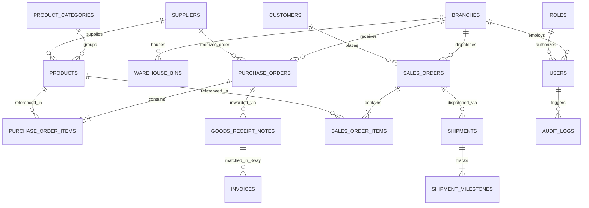

# Motohelp SCM — Enterprise Database Architecture & Guide

## Database Overview
The **Motohelp Private Limited Supply Chain Management Database** is architected in **Third Normal Form (3NF)** with strict relational integrity, foreign key cascading rules, check constraints, and performance indexes.

It powers all 20+ functional modules outlined in the company's project proposal (`Project Details Scm.pdf`), including Multi-Branch Master registries, SKU Catalogs, Inbound Procurement, Inwarding (GRN) with QC, Warehouse 2D Bins, 3PL Logistics Tracking, 3-Way Match Invoicing, and Executive KPI Analytics.

---

## Entity-Relationship (ER) Architecture



---

## Complete Table Directory & Schemas

| Table Name | Primary Key | Description | Key Foreign Keys |
| :--- | :--- | :--- | :--- |
| `branches` | `id` (VARCHAR) | Distribution Hubs, Mega Logistics Depots & Regional Centers | None |
| `roles` | `id` (VARCHAR) | Role-Based Access Control (RBAC) tiers and permission arrays | None |
| `users` | `id` (VARCHAR) | System users with password hashes and active branch | `role_id`, `branch_id` |
| `product_categories` | `id` (VARCHAR) | Automotive taxonomy (Powertrain, Braking, Electricals, etc.) | None |
| `products` | `id` (VARCHAR) | Master SKU Catalog with barcodes, HSN, safety stocks, FSN, ABC | `category_id`, `primary_supplier_id` |
| `suppliers` | `id` (VARCHAR) | OEM Vendor Directory, GSTIN, OTIF score, defect PPM, lead times | None |
| `customers` | `id` (VARCHAR) | Fleet operators, authorized garage networks, credit limits, DSO | None |
| `purchase_requisitions`| `id` (VARCHAR) | Internal procurement requisitions and department requests | `branch_id` |
| `purchase_orders` | `id` (VARCHAR) | Official POs with vendor terms, tax calculations, approval statuses | `vendor_id`, `branch_id` |
| `purchase_order_items`| `id` (AUTOINCREMENT)| Dynamic line items per PO with rates and GST brackets | `po_id`, `product_id` |
| `goods_receipt_notes` | `id` (VARCHAR) | Gate inwarding, QC inspection records (Accepted vs Rejected) | `po_id`, `branch_id` |
| `warehouse_bins` | `id` (VARCHAR) | 2D Spatial mapping (Zones A/B/C/D, Racks, Capacity limits) | `branch_id` |
| `stock_transfers` | `id` (VARCHAR) | Inter-branch inventory transfers and vehicle gate passes | `product_id`, `from_branch_id`, `to_branch_id` |
| `sales_orders` | `id` (VARCHAR) | B2B customer orders, reservations, delivery priorities | `customer_id`, `branch_id` |
| `sales_order_items` | `id` (AUTOINCREMENT)| Line items per Sales Order with GST amounts | `so_id`, `product_id` |
| `shipments` | `id` (VARCHAR) | 3PL Consignments, Waybill numbers, E-Way bills, drivers | `so_id` |
| `shipment_milestones` | `id` (AUTOINCREMENT)| Live waypoint timeline nodes and GPS status checkpoints | `shipment_id` |
| `invoices` | `id` (VARCHAR) | AP (Vendor Bills) & AR (Fleet Invoices) with 3-Way matching | None (Cross-referenced) |
| `audit_logs` | `id` (VARCHAR) | Immutable event log with timestamp, user, role, action, IP | None |
| `notifications` | `id` (VARCHAR) | Real-time system alerts (low stock, pending approvals) | None |

---

## Executive KPI Views Built into the Database

### 1. Supplier OTIF & Quality Defect Index (`view_supplier_otif_kpi`)
```sql
SELECT 
    supplier_name,
    category,
    otif_score,
    defect_ppm,
    rating,
    total_pos_issued,
    total_po_value
FROM view_supplier_otif_kpi
ORDER BY otif_score DESC;
```

### 2. Real-Time Inventory Valuation & Health (`view_inventory_health`)
```sql
SELECT 
    sku,
    product_name,
    current_stock,
    safety_stock,
    total_valuation,
    fsn_category,
    stock_health_status
FROM view_inventory_health
WHERE stock_health_status = 'CRITICAL_REORDER';
```

### 3. Financial 3-Way Match Verification (`view_three_way_match_audit`)
```sql
SELECT 
    invoice_number,
    party_name,
    invoice_amount,
    po_number,
    po_amount,
    grn_number,
    match_status,
    payment_status
FROM view_three_way_match_audit;
```

---

## How to Run & Connect to the Database

### Method A: Using the Local Node.js / SQLite API Server (Out-of-the-Box)
1. Initialize the SQLite database and seed data:
   ```bash
   node database/init_db.js
   ```
2. Start the REST API server:
   ```bash
   node server/index.js
   ```
   The backend will be available at `http://localhost:5001/api/`.

### Method B: PostgreSQL or MySQL Deployment
The `database/schema.sql` file is 100% ANSI SQL compatible. To deploy to a PostgreSQL or MySQL server:
```bash
# PostgreSQL
psql -U postgres -d motohelp_scm -f database/schema.sql

# MySQL
mysql -u root -p motohelp_scm < database/schema.sql
```
