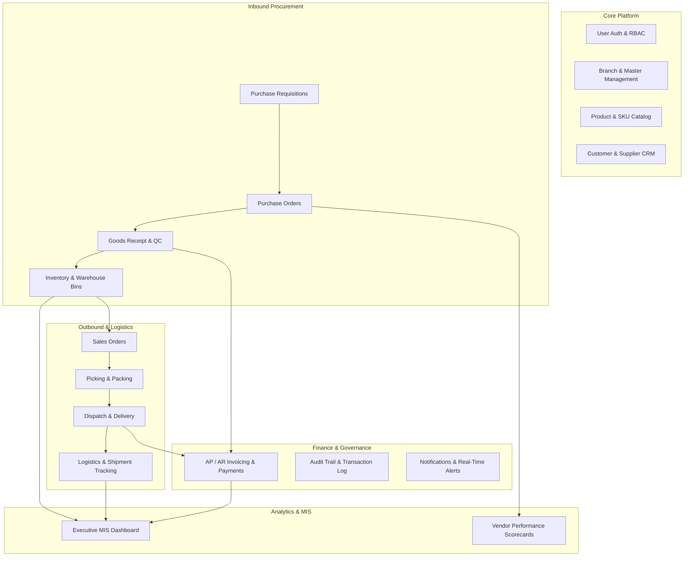

# Motohelp SCM (Supply Chain Management) Platform — Architecture & Implementation Plan

## Executive Overview
**Motohelp Private Limited** requires an enterprise-grade, integrated **Supply Chain Management (SCM) Software Platform** to streamline end-to-end operations across procurement, inventory, warehouse logistics, vendor performance, sales order fulfillment, invoicing, and executive management reporting.

This plan details the full technical blueprint, functional modules (mapped 1:1 to the project proposal), data architecture, and executive KPI dashboard system.

---

## Key Performance Indicators (KPIs) Built into the System

| KPI Category | Metric Name | Definition & Formula | Target / Benchmark |
| :--- | :--- | :--- | :--- |
| **Supplier & Procurement** | **OTIF Rate (On-Time In-Full)** | $\frac{\text{Deliveries On-Time \& Full}}{\text{Total Orders}} \times 100$ | $\ge 95\%$ |
| | **Supplier Defect Rate (PPM)** | $\frac{\text{Rejected Items}}{\text{Total Received}} \times 1,000,000$ | $< 500\text{ PPM}$ |
| | **PO Lead Time** | Avg days from PO creation to Goods Receipt | $< 7\text{ Days}$ |
| **Inventory & Warehousing** | **Inventory Turnover Ratio (ITR)** | $\frac{\text{Cost of Goods Sold (COGS)}}{\text{Average Inventory Value}}$ | $8 - 12\times / \text{yr}$ |
| | **Stock Accuracy Rate** | $\frac{\text{Physical Count Matches}}{\text{System Count Records}} \times 100$ | $\ge 99.2\%$ |
| | **DSI (Days Sales of Inventory)** | $\frac{\text{Avg Inventory}}{\text{COGS}} \times 365$ | $< 30\text{ Days}$ |
| | **Carrying Cost %** | Holding Cost / Total Inventory Value | $< 15\%$ |
| **Fulfillment & Logistics** | **OFTR (Order Fulfillment Time)** | Hours from Sales Order confirmation to Dispatch | $< 24\text{ Hours}$ |
| | **Perfect Order Rate** | Orders delivered on time, complete, damage-free, accurately invoiced | $\ge 96\%$ |
| | **Freight Cost per Unit** | Total Shipping Spend / Total Units Dispatched | Optimized per route |
| **Financial & Cash Flow** | **DPO (Days Payable Outstanding)** | Supplier credit term utilization | $45 - 60\text{ Days}$ |
| | **DSO (Days Sales Outstanding)** | Customer receivables collection cycle | $< 30\text{ Days}$ |

---

## User Review Required

> [!IMPORTANT]
> **Primary Technology Stack Selection:**
> We propose building the initial rich application as a **Vite + React (SPA)** with responsive modular CSS, full interactive state management, local database simulation (IndexedDB/LocalStorage with seed data), and REST API abstraction layer. This allows instant prototyping, demoing, and clean transition to a Node.js/Python backend.
> 
> Please let us know if you have specific backend framework preferences (e.g. Node.js/Express, Python/FastAPI, or .NET/C#) and database preferences (PostgreSQL vs MongoDB vs MS SQL).

> [!TIP]
> **Multi-Branch & Multi-Tenant Support:**
> The master data structure is configured to support multiple branches (e.g. Mumbai HQ / Bhandup Hub, Pune Regional Depot, Delhi NCR Fulfillment Center) with location-specific warehouse binning.

---

## Proposed System Architecture & Modules

### Module Breakdown (All 20+ Proposal Deliverables)

1. **Authentication & RBAC**:
   - Roles: `Admin`, `Procurement Officer`, `Warehouse Manager`, `Logistics Lead`, `Sales Rep`, `Finance Manager`, `Supplier Portal`.
   - Dynamic permission matrix & role-switcher for rapid demonstration.

2. **Master Management & Branch Registry**:
   - Multi-warehouse/branch configurator (Bhandup Central, Bhiwandi Logistic Hub, etc.).
   - Category trees, Unit of Measure (UOM), Tax slabs, Currency settings.

3. **Product & Item Master (SKU Management)**:
   - Automotive parts catalog (Engine parts, lubricants, electricals, brake pads, tires, consumables).
   - Barcode/QR generation, Min/Max reorder points, safety stock calculations, Lead times.

4. **Customer & Supplier (Vendor) Management**:
   - Vendor onboarding, GSTIN, compliance rating, credit limits, payment terms.
   - Vendor performance scorecards (OTIF, quality acceptance %, pricing score).

5. **Procurement Pipeline (PR & PO)**:
   - Multi-tier approval workflow for Purchase Requisitions.
   - Automated PO generation with PDF download and email dispatch simulation.

6. **Inwarding & Quality Control (GRN)**:
   - Goods Receipt Note creation, batch/lot numbering, serial scanning, QC pass/reject routing.

7. **Warehouse Management System (WMS) & Stock Adjustments**:
   - 2D Visual Warehouse Map (Aisles, Racks, Bins).
   - Inter-warehouse stock transfers with gate passes, damage write-offs, cycle counts.

8. **Sales Orders & Fulfillment (SO)**:
   - B2B order booking, credit check, automated stock allocation/reservation.

9. **Dispatch, Delivery & Logistics Tracking**:
   - Waybill generation, consignment booking, 3PL carrier integration (Delhivery, BlueDart, Fleet tracking).
   - Interactive milestone delivery tracker (Booked $\rightarrow$ Picked $\rightarrow$ In-Transit $\rightarrow$ Out for Delivery $\rightarrow$ Delivered).

10. **Invoicing & Accounts (AP/AR)**:
    - 3-Way Matching (PO $\leftrightarrow$ GRN $\leftrightarrow$ Supplier Invoice).
    - Customer tax invoicing, aging reports, payment ledger.

11. **MIS Executive Dashboard & Reports**:
    - Real-time KPI summary tiles, interactive charts (Spend analysis, Inventory aging, Stock velocity ABC/FSN, Order cycle times).
    - Export to CSV/Excel/PDF.

12. **Audit Trail & System Alerts**:
    - Comprehensive event logging (Who changed what and when).
    - Automated threshold alerts (Low stock warnings, pending approvals, shipment delays).

---

## Proposed Implementation Plan

### Step 1: Frontend Workspace Initialization & Setup
- Initialize modern Vite + React application with high-performance bundling and TypeScript/JavaScript.
- Install essential UI packages: `lucide-react` (icons), `recharts` (charts & visualizations), `canvas-confetti` (interactive cues).
- Setup clean CSS design system with CSS custom properties (variables) featuring rich dark/light automotive-grade aesthetics, glassmorphism, responsive grid layouts, and typography.

### Step 2: Data Store & Mock Business Engine
- Build comprehensive mock seed database reflecting **Motohelp Private Limited** (Automotive parts, branches, Indian GST tax structures, realistic procurement/sales cycles, carrier tracking).
- Implement persistent client-side data store with full CRUD operations for POs, SOs, GRNs, Products, and Invoices.

### Step 3: Implement Core Functional Views
- **Header & Sidebar Navigation**: Breadcrumbs, branch selector, role switcher, notification bell, live search.
- **MIS Executive Dashboard**: Dynamic KPI cards with live percentage delta indicators, spend charts, inventory valuation, OTIF gauges.
- **Item Master & Catalog**: Filterable table, stock status badges, barcode modal, add/edit part modal.
- **Procurement & PO Manager**: PR approval flow, PO creator with dynamic line items, GRN generator.
- **Warehouse & Stock Management**: Live inventory levels, visual bin map, stock transfer dialog.
- **Sales & Logistics Tracker**: Order pipeline, dispatch management, live simulated GPS tracking status.
- **Vendor Scorecards**: Supplier rating breakdown, OTIF history, defect tracking.
- **Finance & Invoicing**: 3-way matching view, invoice generator, payment status tracker.
- **Audit Log & Settings**: System event timeline, user permissions matrix, system backup export.

### Step 4: Polish, Testing & Verification
- Test all end-to-end workflows (Create PO $\rightarrow$ Receive GRN $\rightarrow$ Update Stock $\rightarrow$ Create SO $\rightarrow$ Dispatch & Track $\rightarrow$ Invoicing).
- Responsive layout verification for desktop, tablet, and mobile views.
- Visual validation with browser subagent.

---

## Verification Plan

### Automated & Unit Verification
- Build and lint checks (`npm run build`).
- Verify no runtime console errors or broken imports.

### Interactive User Flow Verification
1. **Procurement Flow**: Create a Purchase Requisition $\rightarrow$ Approve $\rightarrow$ Issue PO $\rightarrow$ Complete Goods Receipt (GRN) $\rightarrow$ Confirm stock level increment.
2. **Sales & Logistics Flow**: Place Sales Order $\rightarrow$ Allocate Inventory $\rightarrow$ Generate Dispatch & Waybill $\rightarrow$ Verify Shipment Tracking updates.
3. **KPI Updates**: Verify that OTIF, Inventory Value, and Fulfillment times dynamically update on the MIS Dashboard.
